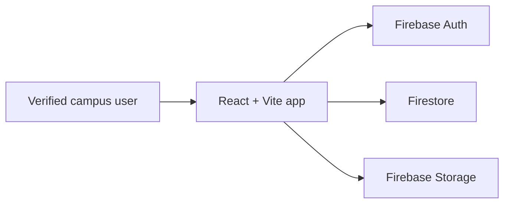

# NileFound

A privacy-focused campus lost-and-found app for Nile University of Nigeria.

**Status:** working prototype; not launched and not yet validated with a student survey.

## Features

- Google sign-in and email/password authentication with verified Nile University email access.
- Email verification, password reset, and account-provider error handling.
- Lost and found item reporting with official campus locations and read-time 60-day expiry.
- Claim workflow with owner/security/admin moderation, restricted private subcollections, and approved handover contact lookup.
- Recipient-scoped notifications and a responsive feed with search-aware pagination and saved filters.
- Firebase Firestore and Storage rules with UID-based ownership, server timestamps, and verified-user checks.
- Installable PWA manifest, self-hosted fonts, hashed-asset caching, and an offline navigation fallback.
- Admin and Campus Security Control Center for moderation, staff roles, custody records, and CSV exports.

## How it works



## Security and privacy

Normal user access requires a verified `@nileuniversity.edu.ng` email. Ownership checks protect item changes, while reporter contact details, claim answers, and verification secrets live in restricted item subcollections. Student ID items block public `imageUrl` fields and photos in Firestore rules as well as the UI, and deleting an item cleans up its private subcollections.

The Firebase web configuration contains public client identifiers. Protection comes from Firebase security rules and HTTP-referrer-restricted API-key settings; never commit service account keys or private credentials. To self-host on a different Firebase project, replace the project owner UID, email, and storage bucket constants in `firestore.rules` and `storage.rules` alongside `firebase-applet-config.json`.

## Tech stack

- React 19
- TypeScript 7 (`strict: true`)
- Vite 8
- Tailwind CSS 4
- Firebase Auth, Firestore, and Storage
- Motion and Lucide React

## Run locally

```bash
npm install
npm run dev
```

Create your own Firebase project, enable Google and Email/Password authentication, configure the Firebase web client values in `firebase-applet-config.json`, update the admin UID/email/bucket in `firestore.rules` and `storage.rules`, and deploy the rules. Then run:

```bash
npm test
npm run lint
npm run build
```

With Java installed locally, you can also run the Firestore emulator rules test suite:

```bash
npm run test:emulator
```

## Project structure

- `src/components/` UI and workflows
- `src/services/` Firebase persistence
- `src/utils/` validation, filtering, matching, and exports
- `firestore.rules` and `storage.rules` security boundaries
- `public/` PWA manifest, icons, service worker, and offline fallback

## Known limitations and roadmap

This prototype has no Cloud Functions or server-side email service; 60-day expiry is applied at read time and via the Admin Desk, and the service worker only caches static assets and fonts rather than private Firebase data. Broader browser testing, App Check enforcement, and student usability research remain outstanding.

## Contributing

Use focused patches, preserve security rules, add tests for rule changes, and do not commit secrets or personal data.

## License

MIT. See `LICENSE`.

## Author

Ayomide — Nile University of Nigeria.
