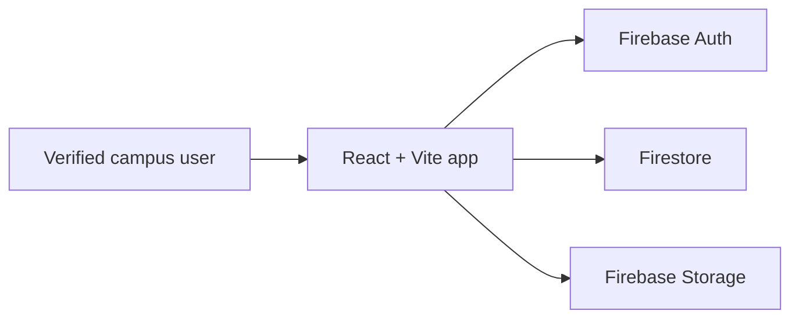

# NileFound

A privacy-focused campus lost-and-found app for Nile University of Nigeria.

**Status:** working prototype; not launched and not yet validated with a student survey.

## Features

- Verified Nile University email authentication with Firebase Auth.
- Lost and found item reporting with official campus locations.
- Privacy-conscious item descriptions, claim workflow, and restricted private details.
- Recipient-scoped notifications and responsive campus feed.
- Firebase Firestore and Storage rules with ownership checks.
- Installable PWA assets and an offline fallback page.

## How it works



## Security and privacy

The app requires a verified school email for normal access. Ownership checks protect item changes, while reporter contact information, claim details, and verification answers are kept in restricted item subcollections. Student ID details are withheld from the public feed.

The Firebase web configuration contains public client identifiers. Protection comes from Firebase rules and domain-restricted API-key settings; never commit private credentials.

## Tech stack

- React 19
- TypeScript 7
- Vite 8
- Tailwind CSS 4
- Firebase Auth, Firestore, and Storage
- Motion and Lucide React

## Run locally

```bash
npm install
npm run dev
```

Create your own Firebase project, enable Google and Email/Password authentication, configure the Firebase web client values, and deploy the Firestore and Storage rules. Then run:

```bash
npm test
npm run lint
npx vite build
```

## Project structure

- `src/components/` UI and workflows
- `src/services/` Firebase persistence
- `src/utils/` validation, filtering, matching, and exports
- `firestore.rules` and `storage.rules` security boundaries
- `public/` PWA manifest, service worker, and offline fallback

## Known limitations and roadmap

This prototype has no Cloud Functions, server-side email service, or production moderation operations. Planned work includes stronger pagination, broader browser testing, App Check enforcement, and student usability research.

## Screenshots

Screenshots belong in `docs/screenshots/`. This repository currently includes a placeholder note rather than generated or private AI Studio media.

## Contributing

Use focused patches, preserve security rules, add tests for rule changes, and do not commit secrets or personal data.

## License

MIT. See `LICENSE`.

## Author

NileFound project author — Nile University of Nigeria.
